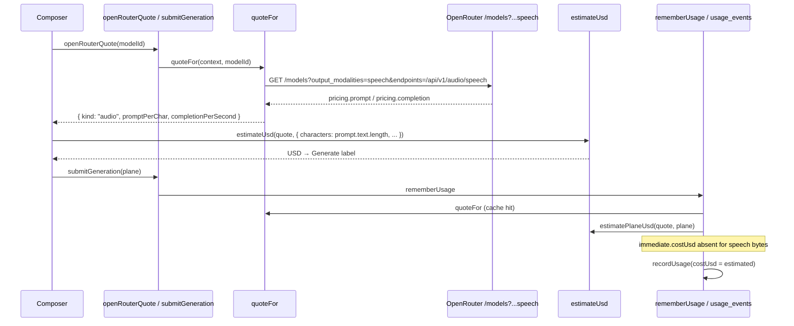

# Audio USD estimate + usage recording — candidate 1

## Problem (from grounding)

`quoteFor` early-returns `null` when `model.surface === "audio"`. Composer already calls `openRouterQuote` → `estimateUsd`, and `rememberUsage` already calls `quoteFor` → `estimatePlaneUsd` → `recordUsage`. Without a quote, the Generate label stays bare and `usage_events` / gallery `costUsd` stay empty.

Speech `POST /audio/speech` returns raw bytes; `submitSpeech` never sets `costUsd`. Recording must therefore rely on the plane estimate (same fallback already used: `immediate?.costUsd ?? estimated`).

## Decision summary

Extend the existing quote → estimate → record path with an `audio` `OpenRouterQuote` variant. Price from `GET /models?output_modalities=speech&endpoints=/api/v1/audio/speech` (`pricing.prompt` / `pricing.completion`). Bill characters from `plane.prompt.text.length` for studio defaults (character-priced TTS). Do not change catalog, browser OpenRouter calls, or `submitSpeech` response parsing in this pass.

---

## 1. Chosen `OpenRouterQuote` audio variant

Add one discriminated arm next to `video` | `image`. Rates are already USD as OpenRouter publishes them (numeric strings → `Number`).

```ts
export type OpenRouterQuote =
  | { kind: "video"; skus: Record<string, number>; sizes?: string[] }
  | { kind: "image"; lines: ImagePriceLine[] }
  | {
      kind: "audio";
      /** USD per input character (`pricing.prompt`). */
      promptPerChar: number;
      /** USD per second of generated audio (`pricing.completion`). */
      completionPerSecond: number;
    };
```

Mapping from the models list row:

| OpenRouter field     | Quote field            | Studio default models (samples) |
|----------------------|------------------------|----------------------------------|
| `pricing.prompt`     | `promptPerChar`        | Flash / Kokoro / Voxtral: > 0    |
| `pricing.completion` | `completionPerSecond`  | usually `0`; Seed Audio: > 0     |

Both rates may be non-zero (e.g. Gemini TTS). Missing / non-finite values → treat as `0`. A quote with both rates `0` is useless; `quoteFor` should return `null` for that slug (same as empty image lines).

---

## 2. `estimateUsd` / `EstimateInput` changes

### `EstimateInput`

```ts
export type EstimateInput = {
  resolution?: string;
  aspectRatio?: string;
  duration?: number;
  audio?: boolean;
  images: number;
  videos: number;
  audios: number;
  batch: number;
  /** Spoken script length; billable text for TTS (`plane.prompt.text`). */
  characters?: number;
};
```

`characters` is optional so image/video callers stay unchanged. Audio estimate treats missing / non-positive as `0`.

### `estimateUsd`

Branch on `quote.kind === "audio"` (today: video vs image only):

```ts
function estimateAudio(
  quote: Extract<OpenRouterQuote, { kind: "audio" }>,
  input: EstimateInput,
): number | null {
  const characters = input.characters && input.characters > 0 ? input.characters : 0;
  const duration = input.duration && input.duration > 0 ? input.duration : 0;
  const total =
    quote.promptPerChar * characters + quote.completionPerSecond * duration;
  return total > 0 ? total : null;
}
```

Reuse the existing finite / `> 0` gate in `estimateUsd`.

**Studio-default behavior (character-priced TTS):** `promptPerChar > 0`, `completionPerSecond === 0` → estimate = `promptPerChar * characters`. Empty prompt → `null` (no `$0.00` on Generate).

**Completion-priced models (Seed Audio):** without a known output duration, estimate stays `null` until duration exists in `EstimateInput`. Do not invent a duration. Out of scope for the smallest lighting-up pass; still record `null` cost rather than a fake number.

**Both rates (Gemini TTS):** characters + duration when duration is known; characters alone when only prompt rate applies to the preview.

`batch` does not multiply audio: one speech request per Generate for current studio audio (no native multi-count TTS). If that changes later, multiply explicitly.

---

## 3. How `quoteFor` fetches prices (path + cache)

### Call path (unchanged entry)

```
Composer → openRouterQuote(modelId) [server action]
        → quoteFor(sessionContext(), modelId)
rememberUsage → quoteFor(context, plane.model)
```

Browser never hits OpenRouter; `pnpm verify:studio` stays clear of `/audio/speech` and OpenRouter from the client.

### Change in `quoteFor`

Remove:

```ts
if (model.surface === "audio") return null;
```

Add an audio branch before/after video/image:

```ts
if (model.surface === "audio") {
  const priced = await speechRates(context.credentials, slug);
  return priced;
}
```

### Exact fetch

`openRouterJson` already prefixes `credentials.baseUrl` (OpenRouter `/api/v1`). Relative path:

```
GET /models?output_modalities=speech&endpoints=/api/v1/audio/speech
```

Full URL equivalent to grounding:

```
GET {baseUrl}/models?output_modalities=speech&endpoints=/api/v1/audio/speech
```

**Not** `/audio/speech/models` — that endpoint supplies voices/formats (already used by `speechCaps`) and has **no** pricing.

Parse `payload.data[]`: match `row.id === slug`, read `row.pricing.prompt` / `row.pricing.completion` as strings → `Number`. Build `{ kind: "audio", promptPerChar, completionPerSecond }` or `null`.

### Cache

Mirror the video list cache (one list refresh, many slug lookups), not the per-slug image map:

```ts
const PRICE_TTL_MS = 5 * 60_000; // existing

let speechPriceCache: {
  at: number;
  models: Map<string, { promptPerChar: number; completionPerSecond: number }>;
} | null = null;
```

- On miss / TTL expiry: one list GET, fill `Map` by model id, set `at = Date.now()`.
- Lookup: `speechPriceCache.models.get(slug)`.
- Same TTL as `videoSkuCache` / `imagePriceCache` / `capsCache`.

Do not merge speech pricing into `capsCache` or `/audio/speech/models`.

---

## 4. Composer + `estimatePlaneUsd` wire for characters

### Composer (`src/openhiggsfield/composer.tsx`)

Today:

```ts
const estimate = quote
  ? estimateUsd(quote, {
      resolution: ...,
      aspectRatio: ...,
      duration: ...,
      audio: ...,
      images: referenceCounts.images,
      videos: referenceCounts.videos,
      audios: referenceCounts.audios,
      batch: batchValue,
    })
  : null;
```

Add:

```ts
characters: prompt.text.length,
```

`prompt` is already `storesFor(surface).prompt()`; for Audio that is `useAudioPrompt`. Spoken script = billable text (`mapSpeech` uses `input: plane.prompt.text`). Mentions that rewrite text before submit should stay consistent: estimate uses the same string the user sees in the field; `estimatePlaneUsd` at record time uses `plane.prompt.text` after assemble (mention resolution). Acceptable small preview vs record drift if mentions expand; prefer recording the submitted plane text.

Generate label already does `Generate{estimate !== null ? ` ${formatUsd(estimate)}` : ""}` and `onGenerate(estimate ?? undefined)` — no label change once estimate is non-null.

### `estimatePlaneUsd` (`src/usage/record.ts`)

Pass characters from the plane:

```ts
return estimateUsd(quote, {
  // ...existing fields...
  characters: plane.prompt.text.length,
});
```

No new imports. When `quote.kind === "audio"`, `estimateUsd` uses `characters` (+ `duration` if present in settings). Audio models typically have no `duration` setting; character-only math covers defaults.

---

## 5. Usage recording when speech returns no `usage.cost`

Current chain in `rememberUsage`:

```ts
const quote = await quoteFor(...).catch(() => null);
const estimated = estimatePlaneUsd(quote, plane);
const costUsd = immediate?.costUsd ?? estimated;
await recordUsage({ ..., costUsd, status: settled ?? "pending" });
```

`submitSpeech` builds `immediate` with `status: "completed"` and audio bytes, **without** `costUsd`. So:

1. `immediate?.costUsd` is `undefined`.
2. After this design, `estimated` is `promptPerChar * plane.prompt.text.length` for character-priced models.
3. `costUsd` written to `usage_events` is that estimate.
4. Immediate completion → `usageStatusFromPlatform("completed")` → `"success"` on insert (not left pending).
5. Gallery / viewer read `cost_usd` → `item.costUsd` as today.

**Do not** change `submitSpeech` to invent a cost from headers, or parse non-JSON usage. Raw audio responses have no `usage.cost`.

**Settle path:** Speech jobs are immediate; they are not polled via `statusesFor` video status. `settleUsage` with a later provider cost will not run for typical speech. The insert-time estimate is the durable cost unless a future speech API starts returning usage and `submitSpeech` sets `costUsd` (then `immediate?.costUsd` wins).

Team spend / credits: `creditsFromUsd(costUsd)` already runs on insert; estimated USD is enough.

Empty prompt edge: `estimated === null` → `costUsd: null` (same as today’s missing quote).

---

## 6. Alternatives considered and rejected

| Alternative | Why rejected |
|-------------|--------------|
| Hardcode per-model USD in catalog / UI | Violates “catalog = models, not parallel price list”; drifts from OpenRouter. |
| Price from `/audio/speech/models` | No pricing fields (grounding). Caps stay on that endpoint; quotes stay on `/models?...`. |
| Separate client-side estimate math | Browser must not call OpenRouter; would fork from `estimateUsd`. |
| Only show estimate; skip `usage_events` | Gallery `costUsd` would stay empty; `rememberUsage` already shares the quote path. |
| Full duration-aware audio estimate for Seed-style models in v1 | Needs output length before generate; not available for studio defaults. Prefer character-priced path first. |
| New quote kind with opaque `skus` map | Overkill; speech pricing is two flat rates, not video SKUs / image lines. |

---

## 7. Risks

1. **OpenRouter unit semantics** — Assumed `prompt` = USD/char and `completion` = USD/sec. If a model redefines units, estimates skew; mitigate by checking samples after list fetch in tests/fixtures, not by hardcoding rates in UI.
2. **Completion-only models** — Seed Audio style stays estimate/`costUsd` null until duration is wired; users see no Generate `$` for those models.
3. **Preview vs recorded characters** — Composer uses live `prompt.text`; record uses assembled plane (mention resolution). Rare mismatch if mentions expand the billed string.
4. **List endpoint size / latency** — Full speech models list every TTL (same pattern as `/videos/models`). Cache miss on first Audio model switch can delay the `$` label briefly.
5. **Query-string encoding** — `endpoints=/api/v1/audio/speech` must be passed as OpenRouter expects; wrong encoding → empty list → null quotes (silent empty estimate).
6. **Verify harness** — `pnpm verify:studio` must keep driving only server actions; quote fetch stays server-side. Do not assert live OpenRouter prices in the browser drive.
7. **Very cheap Kokoro-class rates** — `formatUsd` uses 3 decimals below $1; sub-mill rates may round visually (`$0.001`) while stored float stays precise enough for credits.

---

## Implementation touch list (for a later coding pass — not done here)

| File | Change |
|------|--------|
| `src/generation/estimate.ts` | Audio quote arm; `characters` on input; `estimateAudio` |
| `src/generation/engine.ts` | Audio branch in `quoteFor`; `speechRates` + `speechPriceCache`; drop audio `null` early-return |
| `src/usage/record.ts` | Pass `characters: plane.prompt.text.length` |
| `src/openhiggsfield/composer.tsx` | Pass `characters: prompt.text.length` |

No catalog edits. No `submitSpeech` cost invention. Gate with `pnpm typecheck` and `pnpm verify:studio` after implementation.

---

## Flow (after change)


