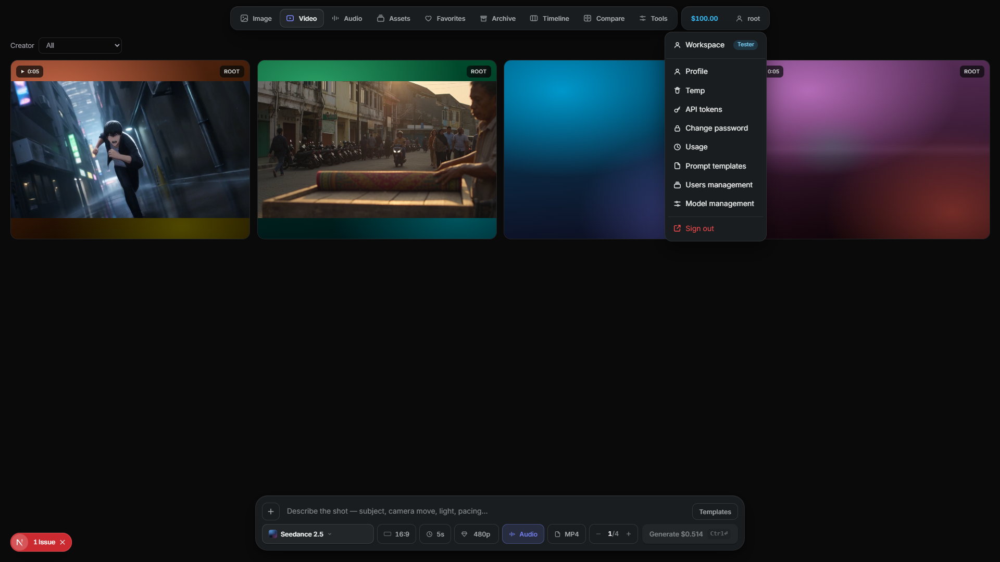
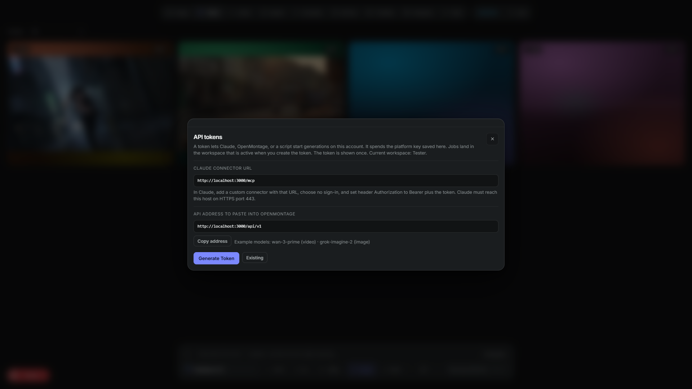
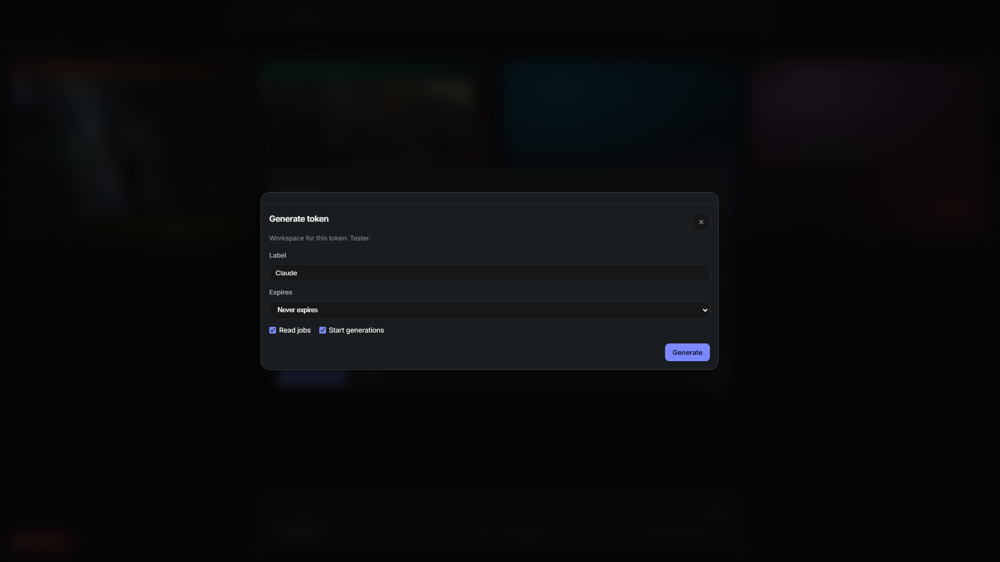
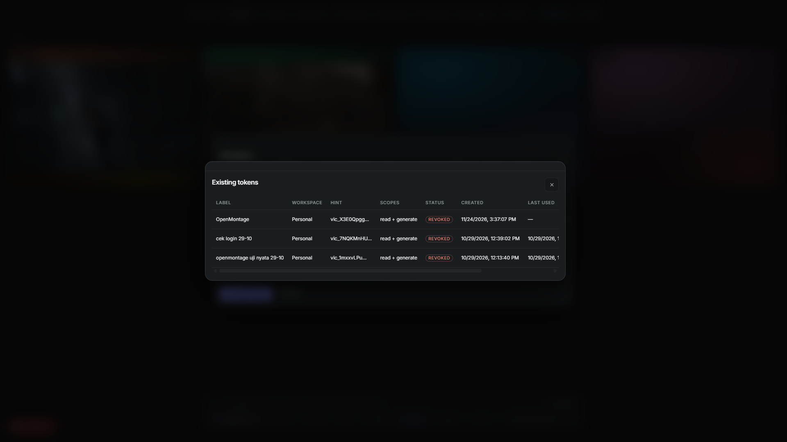

# Pasang Vicend sebagai connector Claude

Gambar di bawah diambil dari studio yang sedang login (workspace Tester). Langkah di claude.ai mengikuti [panduan custom connector Anthropic](https://support.claude.com/en/articles/11175166-get-started-with-custom-connectors-using-remote-mcp). Layar claude.ai tidak difoto di sini karena butuh akun Claude Anda, dan host `localhost` tidak bisa dijangkau Anthropic.

Ganti `http://localhost:3000` dengan URL publik Vicend Anda. Claude hanya menerima `https` di port 443.

## 1. Buka API tokens

Login Vicend. Pilih workspace dulu (Personal atau tim). Token yang dibuat mengikuti workspace yang sedang aktif.

Klik nama akun di kanan atas, lalu **API tokens**.

## 2. Salin URL connector

Di panel API tokens, salin **Claude connector URL**. Contoh lokal `http://localhost:3000/mcp`. Di server publik bentuknya `https://domain-anda/mcp`.

Tombol **Generate Token** dan **Existing** ada di bawah alamat itu.

## 3. Buat token

Klik **Generate Token**. Isi label (misalnya `Claude`). Biarkan **Read jobs** dan **Start generations** tercentang. Klik **Generate**.

Token lengkap (`vic_...`) hanya muncul sekali. Salin sebelum menutup kotak itu. Nilai header di Claude adalah `Bearer ` diikuti token, termasuk spasi setelah Bearer.

## 4. Kelola token yang sudah ada

**Existing** membuka tabel. Token aktif punya **Revoke**. Setelah statusnya revoked (atau kedaluwarsa), tombol **Delete** muncul di kolom Actions. Geser tabel ke kanan bila kolom itu terpotong.

## 5. Tambah connector di Claude

Di claude.ai (paket Pro, Max, atau Ultra):

1. Buka **Customize**, lalu **Connectors**.
2. **Add**, lalu **Add custom connector**.
3. Nama, misalnya `Vicend`.
4. URL persis dari langkah 2, termasuk `/mcp`.
5. Authentication: **No sign in**.
6. Request headers: nama `Authorization`, nilai `Bearer vic_...`.
7. **Add**.

Di paket Team atau Enterprise, pemilik organisasi menambah connector lewat **Organization settings**, **Connectors**, **Add**, **Custom**, **Web**. Anggota lalu mengaktifkannya sendiri. Bagian Request headers di organisasi Claude masih beta. Bila bagian itu tidak muncul, paket itu belum bisa menempel API key. Pakai akun Pro atau Max, atau minta akses ke `mcp-review@anthropic.com`.

## 6. Pakai di percakapan

Nyalakan connector Vicend pada chat. Minta Claude, berurutan:

1. `vicend_list_models` untuk melihat model gambar, video, atau audio.
2. `vicend_generate` dengan `model` dan `prompt`.
3. `vicend_job` dengan `requestId` sampai status selesai atau gagal.

Job tercatat di akun pemilik token dan di workspace yang aktif saat token dibuat. Cek di galeri dan halaman Usage Vicend.

`vicend_whoami` menjawab username, label token, dan workspace.
