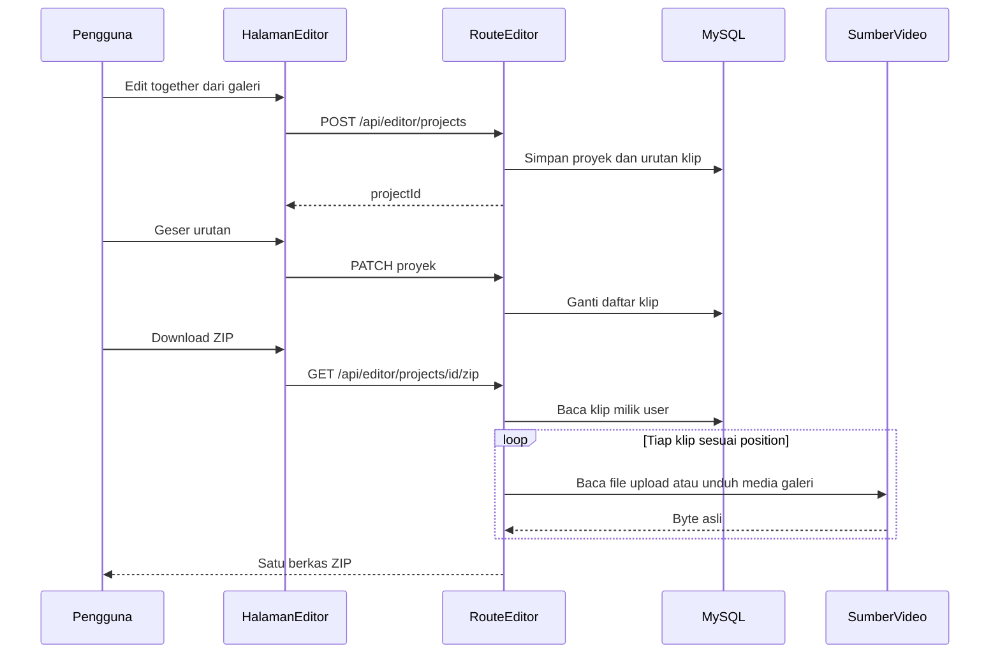

# SDD — Modul Editor

| Item | Nilai |
| --- | --- |
| Produk | OpenHiggsfield AI (`video-gen`) |
| Modul | Editor |
| Status | Desain (belum diimplementasi) |
| Versi dokumen | 1.1 |
| Tanggal | 2026-10-28 |
| Perubahan | Export adalah ZIP berurutan. Tidak ada render atau penggabungan video. |

Dokumen ini adalah spesifikasi desain. Query SQL di dalamnya **hanya teks untuk dijalankan manual**. Agen atau skrip tidak mengeksekusi `CREATE` / `ALTER` / `INSERT` dari chat.

Menyambung beberapa video menjadi satu MP4 membutuhkan render (FFmpeg atau setara). Itu **di luar modul ini**. Jika nanti dibutuhkan, buat modul terpisah. Editor di sini hanya menyusun urutan lalu mengunduh berkas asli sekaligus.

---

## 1. Ringkasan

Editor adalah papan urutan video di dalam studio. Pengguna memilih video dari galeri generate atau dari upload, menggeser urutannya, lalu mengunduh **satu berkas ZIP**. Isi ZIP adalah byte asli tiap video. Nama berkas di dalam arsip memakai nomor urut (`01-….mp4`, `02-….mp4`) supaya setelah diekstrak urutan susunan tetap terbaca di folder.

Tidak ada transcode, trim yang memotong file, perubahan resolusi, fps, volume, atau job render.

### 1.1 Masalah yang diselesaikan

Selection bar galeri (`src/openhiggsfield/selection-bar.tsx`) mengunduh tiap run sebagai file terpisah lewat `downloadPicked` di `src/openhiggsfield/openhiggsfield-app.tsx`. Unduhan itu berurutan di antrean browser, tetapi nama file tidak membawa nomor susunan, mudah tercecer, dan tidak bisa diatur ulang sebelum diunduh. Editor memberi satu arsip dengan urutan yang pengguna tentukan.

### 1.2 Tujuan

1. Membuka proyek dari galeri (**Edit together**, minimal 2 video selesai) atau dari `/editor`.
2. Menyusun ulang klip (naik, turun, atau seret).
3. Menyimpan proyek per akun di MySQL agar urutan tidak hilang saat pindah perangkat.
4. Mengunduh satu `.zip` yang berisi video asli sesuai urutan proyek.
5. Menolak sumber yang bukan milik akun yang sedang login.

### 1.3 Di luar cakupan

- Render, concat, FFmpeg, ffprobe, kanvas, fps, codec, audio mix.
- Trim, potong, kecepatan, transisi, teks, musik, keyframe.
- Mengubah byte video sama sekali (termasuk remux).
- Pratinjau yang memutar semua klip sebagai satu timeline tersambung. v1 cukup pemutar satu klip yang sedang dipilih, memakai URL yang sama dengan galeri.
- Mengunggah ZIP kembali ke OpenRouter.
- Antrean render dan tabel status job.

### 1.4 Persona

| Persona | Kebutuhan |
| --- | --- |
| Kreator studio | Mengambil 2–12 klip, mengurutkan cerita, mengunduh satu ZIP. |
| Operator self-host | Tidak memasang FFmpeg untuk fitur ini. Server hanya membaca file dan menulis ZIP. |
| Tamu | Tidak membuka editor. Butuh akun `active` (`requireActiveUser` di `src/auth/guard.ts`). |

### 1.5 Definisi hasil

Satu file `.zip` yang:

- Berisi tepat satu entri per klip, tidak ada folder bersarang wajib (entri di akar arsip).
- Urutan entri dan awalan nama `01`, `02`, … sama dengan `position` klip (0 → `01`).
- Byte tiap entri sama dengan sumber (upload di disk, atau body unduhan URL galeri). Tidak di-encode ulang.
- Ekstensi mengikuti sumber (`.mp4`, `.webm`, …). Jika tidak dikenal, pakai `.mp4` hanya sebagai nama, tanpa mengubah isi.
- Bisa dibuka di Explorer, Finder, dan `unzip` standar.

---

## 2. Riset alat

### 2.1 Keadaan kode saat ini

| Area | Fakta | Implikasi |
| --- | --- | --- |
| UI | Next.js 16, React 19, Zustand, CSS `ohf-*` | Halaman editor mengikuti shell studio. |
| Galeri | `RunRecord` di `src/openhiggsfield/history.ts`: `kind`, `urls`, `status`, `id` | Hanya `kind === "video"`, `status === "completed"`, `urls[0]` ada. |
| Persistensi hasil | `generation_results` (`user_id`, `client_id`, `payload` JSON) | Klip menyimpan `client_id` + indeks URL, bukan salinan video di DB. |
| Media generate | URL CDN atau `GET /api/media?job=&index=` (`src/app/api/media/route.ts`) dengan kunci akun | Saat mengemas ZIP, server mengunduh byte lewat jalur yang sama. Klien tidak mengirim URL sembarangan. |
| Upload | `uploads/` lewat `uploadRoot()` di `src/generation/local-upload.ts`, id UUID | Entri ZIP dibaca dari path yang server susun, bukan dari path klien. |
| Unduh galeri | `src/openhiggsfield/download.ts` menyimpan satu blob per file di browser | ZIP editor adalah satu respons unduhan. Unduhan massal galeri tetap ada. |
| Dependensi | `package.json` tidak memuat pustaka ZIP | Tambah satu pustaka ZIP saat implementasi. |

### 2.2 Mesin ZIP

| Opsi | Keputusan |
| --- | --- |
| **`fflate` (Zip pass-through / `Zip` stream)** | **Dipilih.** Murni JavaScript, cocok untuk Node 20+, bisa `zip.add` dari stream atau buffer per file. Metode `STORE` (tanpa deflate) untuk video: video sudah terkompresi, deflate hanya membakar CPU tanpa mengecilkan ukuran. |
| `archiver` | Cadangan jika stream `fflate` tidak nyaman. Dependensi lebih berat. |
| JSZip memuat semua file ke RAM | Ditolak untuk beberapa video puluhan MB. |
| ZIP di browser (`fflate` di klien) yang mengunduh tiap URL lalu mengemas | Ditolak sebagai jalur utama. URL CDN sering tanpa CORS untuk `fetch` dari halaman, dan kunci `/api/media` lebih aman di server. |
| FFmpeg | Tidak dipakai. |

Saat implementasi, tambahkan `fflate` ke `dependencies`. Tidak ada binary sistem.

### 2.3 UI urutan

Daftar vertikal sudah cukup untuk v1: nomor, label, tombol naik/turun, seret untuk mengubah posisi, hapus. Timeline trim tidak dibuat.

`@tanstack/react-virtual` yang sudah ada boleh dipakai jika daftar pustaka panjang. Daftar urutan proyek maksimal 12 item, tidak perlu virtualisasi.

### 2.4 Penyimpanan

| Lokasi | Isi |
| --- | --- |
| `uploads/` | Sumber upload, sudah ada |
| Tidak ada folder `exports/` wajib | ZIP di-stream ke respons HTTP. Tidak disimpan permanen. |

Jika satu sumber harus diunduh dari CDN ke disk dulu (supaya tidak menahan banyak buffer), pakai `editor-work/{requestId}/` yang dihapus di `finally`. Boleh juga mem-pipe body `fetch` langsung ke entri ZIP tanpa menyimpan salinan, selama batas ukuran diperiksa saat membaca.

---

## 3. Alur pengguna

### 3.1 Masuk dari galeri

1. Pengguna login, status `active`.
2. Di galeri scope Video, centang minimal 2 run `completed` yang punya URL.
3. Selection bar menampilkan **Edit together** di samping Download, Favorite, dan Delete.
4. `POST /api/editor/projects` membuat proyek. Urutan awal mengikuti pilihan, diurutkan `createdAt` naik (cerita mengikuti waktu buat). Pengguna boleh mengubahnya sebelum unduh.
5. Aplikasi membuka `/editor/{projectId}`.

Jika yang dicentang campuran gambar dan video, hanya video yang dihitung. Kurang dari 2 video: tombol nonaktif.

### 3.2 Menyusun

1. `/editor` menampilkan daftar proyek dan tombol proyek baru (papan kosong).
2. Panel kiri: pustaka. Tab **Galeri** dan **Upload**. Tambah klip ke papan.
3. Panel kanan (atau bawah di layar sempit): urutan bernomor. Naik, turun, seret, hapus.
4. Memilih satu baris memutar video itu di pemutar tunggal (URL galeri / upload lewat route yang sudah ada). Tidak ada playhead gabungan.
5. Simpan otomatis (debounce ~800 ms) lewat `PATCH` yang mengirim daftar klip lengkap.

### 3.3 Export ZIP

1. Tombol **Download ZIP** aktif jika klip minimal 2.
2. Browser membuka `GET /api/editor/projects/:id/zip` (tautan dengan cookie session, atau `fetch` + blob jika perlu menampilkan progres).
3. Server memeriksa kepemilikan, membaca tiap sumber sesuai `position`, menulis entri `STORE`, mengirim `Content-Type: application/zip` dan `Content-Disposition: attachment`.
4. Nama unduhan: nama proyek yang disanitasi + `.zip`.
5. Gagal di tengah (sumber hilang, terlalu besar): respons `4xx`/`5xx` JSON **sebelum** byte ZIP ditulis. Setelah stream dimulai, koneksi diputus; UI untuk `fetch` menampilkan gagal. Karena itu server menghitung ukuran dan keberadaan sumber **sebelum** menulis header ZIP.

### 3.4 Wireframe teks

```
+------------------------------------------------------------------+
| Topbar studio     Editor / Nama proyek         [Download ZIP]    |
+---------------------------+--------------------------------------+
| Pustaka                   | Urutan                               |
| [Galeri] [Upload]         | 01  klip A          [naik][turun][x] |
| cari                      | 02  klip B          [naik][turun][x] |
| [Tambah] video ...        | 03  klip C          [naik][turun][x] |
| [Tambah] video ...        |                                      |
+---------------------------+--------------------------------------+
| Pemutar klip yang dipilih                                        |
+------------------------------------------------------------------+
```

Keyboard:

| Tombol | Aksi |
| --- | --- |
| Alt+Panah atas / bawah | Geser klip terpilih |
| Delete / Backspace | Hapus klip terpilih |
| Ctrl/Cmd+S | Simpan segera |

---

## 4. Arsitektur



### 4.1 Batas modul (saat dibangun)

| Path rencana | Peran |
| --- | --- |
| `src/app/editor/page.tsx` | Daftar proyek |
| `src/app/editor/[projectId]/page.tsx` | Papan urutan |
| `src/editor/ui/*` | Pustaka, daftar urutan, pemutar satu klip |
| `src/app/api/editor/projects/route.ts` | Daftar dan buat |
| `src/app/api/editor/projects/[id]/route.ts` | Baca, ubah, hapus |
| `src/app/api/editor/projects/[id]/zip/route.ts` | Stream ZIP |
| `src/app/api/editor/library/route.ts` | Galeri video selesai dan upload milik user |
| `src/editor/sources.ts` | Resolusi sumber dan cek pemilik |
| `src/editor/zip.ts` | Susun entri `01-…` dan pipe `fflate` |
| `database/migrations/004_editor.sql` | Teks migrasi untuk operator |

Query di modul `src/editor/`, memakai `src/db/client.ts`. Bukan di dalam komponen React.

### 4.2 Tidak ada worker

Permintaan ZIP selesai di dalam satu request HTTP. Tidak ada status `queued` / `rendering`. Timeout platform (proxy Laragon / Node) harus cukup untuk mengunduh sumber terbesar yang diizinkan. Batas ukuran di bagian 6 menjaga permintaan tetap masuk akal.

---

## 5. Model data

Waktu dan durasi tidak disimpan. Klip hanya referensi sumber dan posisi.

```sql
-- File: database/migrations/004_editor.sql
-- Purpose: Proyek editor (urutan klip saja)
-- Jalankan manual lewat migrasi proyek setelah review.

CREATE TABLE IF NOT EXISTS editor_projects (
  id BIGINT UNSIGNED NOT NULL AUTO_INCREMENT,
  user_id BIGINT UNSIGNED NOT NULL,
  name VARCHAR(191) NOT NULL,
  created_at TIMESTAMP NOT NULL DEFAULT CURRENT_TIMESTAMP,
  updated_at TIMESTAMP NOT NULL DEFAULT CURRENT_TIMESTAMP ON UPDATE CURRENT_TIMESTAMP,
  PRIMARY KEY (id),
  KEY idx_editor_projects_user (user_id, updated_at),
  CONSTRAINT fk_editor_projects_user
    FOREIGN KEY (user_id) REFERENCES users (id)
    ON DELETE CASCADE
) ENGINE=InnoDB DEFAULT CHARSET=utf8mb4 COLLATE=utf8mb4_unicode_ci;

CREATE TABLE IF NOT EXISTS editor_clips (
  id BIGINT UNSIGNED NOT NULL AUTO_INCREMENT,
  project_id BIGINT UNSIGNED NOT NULL,
  position INT UNSIGNED NOT NULL,
  source_kind ENUM('generation', 'upload') NOT NULL,
  generation_client_id VARCHAR(191) NULL,
  generation_url_index SMALLINT UNSIGNED NOT NULL DEFAULT 0,
  upload_id CHAR(36) NULL,
  label VARCHAR(191) NOT NULL DEFAULT '',
  PRIMARY KEY (id),
  UNIQUE KEY uq_editor_clips_order (project_id, position),
  CONSTRAINT fk_editor_clips_project
    FOREIGN KEY (project_id) REFERENCES editor_projects (id)
    ON DELETE CASCADE
) ENGINE=InnoDB DEFAULT CHARSET=utf8mb4 COLLATE=utf8mb4_unicode_ci;
```

Tidak ada tabel `editor_exports`.

### 5.1 Aturan klip

- `position` rapat `0 .. n-1` setelah setiap simpan.
- `source_kind = generation`: `generation_client_id` ada di `generation_results` untuk `user_id` yang sama, payload video, status selesai, indeks URL valid.
- `source_kind = upload`: `upload_id` UUID milik user.
- Maks 12 klip per proyek.
- Minimal 2 klip untuk mengunduh ZIP. Proyek dengan 0–1 klip boleh disimpan.

### 5.2 Kepemilikan upload

Editor hanya menerima upload yang tercatat milik user. Jika alur upload saat ini belum menyimpan `user_id`, tambahkan tabel berikut dan isi saat `POST` upload, sebelum tab Upload di editor diaktifkan.

```sql
CREATE TABLE IF NOT EXISTS user_uploads (
  id CHAR(36) NOT NULL,
  user_id BIGINT UNSIGNED NOT NULL,
  original_name VARCHAR(255) NOT NULL,
  mime VARCHAR(127) NOT NULL,
  bytes BIGINT UNSIGNED NOT NULL,
  created_at TIMESTAMP NOT NULL DEFAULT CURRENT_TIMESTAMP,
  PRIMARY KEY (id),
  KEY idx_user_uploads_user (user_id, created_at),
  CONSTRAINT fk_user_uploads_user
    FOREIGN KEY (user_id) REFERENCES users (id)
    ON DELETE CASCADE
) ENGINE=InnoDB DEFAULT CHARSET=utf8mb4 COLLATE=utf8mb4_unicode_ci;
```

Implementasi membaca `src/generation/upload.ts` dan route yang menulis disk, lalu menyimpan baris ini. File tanpa baris ditolak.

### 5.3 Konflik dua tab

`PATCH` mengirim `updated_at` terakhir yang diterima klien. Jika baris di database lebih baru, respons `409` dan UI memuat ulang.

### 5.4 Hapus proyek

`DELETE` menghapus klip lewat FK cascade. Tidak ada file ZIP yang ditinggalkan di disk.

---

## 6. API

Semua route memakai session yang sama dengan studio. `requireActiveUser()`. Setiap baca difilter `user_id`. Error JSON: `{ "detail": "..." }`.

Path di bawah adalah route Next, sebelum base path deployment. Klien memakai `withBasePath` (`src/base-path.ts`).

### 6.1 Proyek

`GET /api/editor/projects`

- Query `limit` default 30, maks 100.
- Respons: `{ projects: [{ id, name, updatedAt, clipCount }] }`.

`POST /api/editor/projects`

```json
{
  "name": "Cerita 1",
  "clips": [
    {
      "sourceKind": "generation",
      "generationClientId": "client-id",
      "generationUrlIndex": 0
    },
    {
      "sourceKind": "upload",
      "uploadId": "uuid"
    }
  ]
}
```

- `clips` boleh kosong. Lebih dari 12 ditolak `400`.
- Sumber bukan video selesai atau bukan milik user: `400`.
- Respons `201`: `{ id, name, clips }`.

`GET /api/editor/projects/:id` — proyek + klip terurut.

`PATCH /api/editor/projects/:id`

- `name` opsional.
- `clips` opsional, array penuh pengganti (bukan patch per indeks).

`DELETE /api/editor/projects/:id` — `204`.

`GET /api/editor/library?tab=generation|upload&q=`

- Generation: video selesai milik user dari `generation_results`.
- Upload: baris `user_uploads` dengan mime `video/*`.
- Tidak mengembalikan path disk.

### 6.2 ZIP

`GET /api/editor/projects/:id/zip`

- Klip kurang dari 2: `400`.
- Proyek orang lain: `404`.
- Salah satu sumber hilang atau bukan video: `409` dengan `detail` yang menyebut label klip, tanpa path mesin.
- Jumlah byte sumber (dari `Content-Length` unduhan atau `stat` file) dijumlahkan dulu. Jika satu file > `EDITOR_MAX_SOURCE_BYTES` (default 200 MB) atau total > `EDITOR_MAX_ZIP_BYTES` (default 1 GB): `413`.
- Sukses: stream ZIP.
  - `Content-Type: application/zip`
  - `Content-Disposition: attachment; filename="nama-proyek.zip"`
  - `Cache-Control: private, no-store`

Nama entri:

```text
01-label.mp4
02-label.webm
```

- Nomor dua digit (cukup sampai 12).
- `label` dari klip, jika kosong dari nama asli upload atau `clip`.
- Sanitasi: huruf, angka, spasi, `-`, `_`. Maks 60 karakter. Buang path (`/`, `\`, `..`).
- Jika dua label bentrok, nomor awalan sudah unik.

Metode kompresi entri: **STORE** (ukuran entri ≈ ukuran video + overhead ZIP kecil).

### 6.3 Mengambil byte sumber

- Upload: `createReadStream` pada `path.join(uploadRoot(), id)` setelah UUID lolos dan `user_uploads.user_id` cocok. `path.resolve` hasilnya harus tetap di dalam `uploadRoot()`.
- Generation, file upload lokal yang tersimpan di payload: salin lewat helper yang sama.
- Generation, `https` host yang sudah dikenal platform: `fetch` dengan timeout, tanpa mengikuti redirect ke host lain.
- Generation, path `/api/media?job=&index=`: panggil fungsi unduh yang sama dengan `src/app/api/media/route.ts` di proses ini (kunci `resolveUserCredentials` pemilik), jangan HTTP ke diri sendiri dan jangan menerima URL dari body klien.

Klien tidak pernah mengirim URL mentah pada `POST`/`PATCH`. Server membaca URL dari payload `generation_results`.

### 6.4 Batas

| Env | Default | Arti |
| --- | --- | --- |
| `EDITOR_MAX_CLIPS` | `12` | Per proyek dan per ZIP |
| `EDITOR_MAX_SOURCE_BYTES` | `209715200` | Per video |
| `EDITOR_MAX_ZIP_BYTES` | `1073741824` | Jumlah ukuran sumber |
| `EDITOR_FETCH_TIMEOUT_MS` | `120000` | Per sumber remote |

Tidak ada `FFMPEG_PATH`.

---

## 7. Keamanan

| Risiko | Kendali |
| --- | --- |
| Path traversal | `upload_id` hanya `[0-9a-f-]{36}`. Path final wajib di dalam `uploadRoot()`. |
| IDOR proyek atau file | `user_id` pada setiap query. ZIP tidak dilayani hanya dengan id. |
| SSRF | URL tidak datang dari klien. Host remote di-allow-list. Redirect lintas host ditolak. |
| Zip-slip (nama entri berisi `../`) | Nama entri dibuat server dari nomor + label yang sudah disanitasi. |
| MIME palsu | Galeri: hanya payload video selesai. Upload: mime `video/*` **dan** tolak jika ukuran 0. v1 tidak mewajibkan ffprobe. |
| DoS disk / RAM | Batas jumlah, batas byte, stream STORE, jangan `readFile` seluruh video ke satu array jika file besar. |
| Bocoran kunci OpenRouter | Tetap di server. |
| Akses folder publik | ZIP tidak ditulis ke `public/`. |

Superadmin tidak mendapat daftar proyek user lain lewat API ini.

---

## 8. UI dan integrasi studio

### 8.1 Rute

| URL | Halaman |
| --- | --- |
| `/editor` | Daftar proyek, proyek baru |
| `/editor/[projectId]` | Pustaka + urutan + pemutar satu klip |

`/editor` membutuhkan login, sama seperti generate. Sesuaikan penjaga yang sudah memproteksi halaman akun (`src/proxy.ts` bila rute itu ikut di situ).

### 8.2 Selection bar

Tambah **Edit together** pada `SelectionBar`:

- Aktif bila sedikitnya 2 record `kind === "video"`, `status === "completed"`, dan `urls[0]` ada.
- Memanggil `POST /api/editor/projects` lalu `router.push` ke proyek baru.

**Download** massal yang sudah ada tidak diubah: tetap satu file per run, tanpa ZIP.

Tautan **Editor** di menu akun (dekat Usage) membuka `/editor`.

### 8.3 Tampilan

- Token `ohf-*`, `src/app/base.css`, `openhiggsfield.css`.
- Layar lebar: pustaka dan urutan berdampingan. Layar sempit: urutan di bawah pustaka.
- Label kontrol mengikuti bahasa selection bar yang sudah Inggris: **Edit together**, **Download ZIP**, **Upload**.
- Tombol ZIP menampilkan keadaan sibuk sampai unduhan selesai atau gagal. Pesan gagal dari field `detail`, bukan stack trace.

### 8.4 Aksesibilitas

- Daftar urutan adalah `listbox` atau `ol` dengan tombol yang bisa difokus keyboard.
- Naik/turun tidak hanya mengandalkan seret.
- Fokus klip terpilih terlihat.

### 8.5 Yang tidak diubah

- Katalog model, generate, polling, IndexedDB history.
- Viewer galeri tetap mengunduh satu file.
- Proyek editor bukan baris di IndexedDB. MySQL sumber kebenarannya.

---

## 9. Penerimaan, uji, fase

### 9.1 Kriteria terima

1. Dua video atau lebih dari galeri menghasilkan satu ZIP. Urutan entri sama dengan urutan di papan.
2. Nama entri diawali `01`, `02`, … sesuai posisi.
3. Byte entri sama dengan sumber (ukuran dan cuplikan hash pada fixture lokal).
4. Upload milik user yang sama bisa disisipkan di antara klip galeri.
5. Menggeser urutan lalu mengunduh lagi mengubah nomor awalan sesuai susunan baru.
6. User lain mendapat `404` untuk proyek dan untuk ZIP.
7. `upload_id` dengan `../` ditolak.
8. 13 klip ditolak. Total ukuran di atas batas ditolak sebelum stream ZIP.
9. Sumber galeri yang sudah dihapus menghasilkan `409`, bukan ZIP setengah berisi tanpa penjelasan.
10. Download massal di galeri tetap mengunduh file terpisah.

### 9.2 Rencana uji

| Uji | Cara |
| --- | --- |
| Nama dan urutan entri | Fixture dua file kecil. Baca daftar pusat ZIP (tanpa mengekstrak ke folder acak) dan bandingkan urutan serta ukuran. |
| STORE | Metode kompresi entri adalah store, bukan deflate. |
| API | Kurang dari 2 klip, 13 klip, proyek user lain, id bukan UUID. |
| UI | Edit together, geser urutan, Download ZIP, buka arsip. Verifikasi browser wajib saat fitur ini dibangun. |

### 9.3 Risiko

| Risiko | Dampak | Mitigasi |
| --- | --- | --- |
| URL CDN kedaluwarsa | ZIP gagal `409` | Pesan minta generate ulang atau unggah file. |
| CORS tidak relevan | Server yang mengunduh | Jangan mengemas ZIP di browser. |
| Timeout proxy pada file besar | Unduhan terputus | Batas 200 MB per file dan 1 GB total. Dokumentasikan timeout proxy bila dinaikkan. |
| Upload tanpa pemilik | IDOR | `user_uploads` wajib sebelum tab Upload aktif. |
| Pengguna mengira ZIP adalah satu video tersambung | Salah paham | Teks tombol **Download ZIP** dan kalimat di dialog: berkas tetap terpisah, hanya diurutkan. |

### 9.4 Fase implementasi (perkiraan, satu pengembang)

| Fase | Isi | Perkiraan |
| --- | --- | --- |
| 0 | Migrasi SQL manual, `user_uploads` pada alur upload, dependensi `fflate` | 0,5–1 hari |
| 1 | CRUD proyek dan pustaka | 1 hari |
| 2 | UI urutan, Edit together, tautan Editor | 1–2 hari |
| 3 | Stream ZIP, batas ukuran, uji fixture dan IDOR | 1–2 hari |

Total kasar **4–6 hari**. Bukan komitmen jadwal.

### 9.5 Di luar dokumen ini

Jika suatu saat produk harus menghasilkan **satu file video tersambung**, itu spesifikasi baru (render). Jangan menyisipkan FFmpeg ke modul ZIP ini tanpa SDD tersendiri.

---

## 10. Lampiran — pemetaan kode hari ini

| Kebutuhan | Kode yang dipakai ulang |
| --- | --- |
| Login | `requireActiveUser` |
| Media OpenRouter | `resolveUserCredentials` dan pola `src/app/api/media/route.ts` |
| Path upload | `uploadRoot`, `uploadIdFrom` |
| Base path | `withBasePath` |
| Bentuk run | `RunRecord` |
| Pilihan jamak | `SelectionBar` |
| DB | `src/db/client.ts` |

Pada tanggal dokumen ini belum ada modul editor di repositori. Dokumen ini tidak mengubah kode tersebut.
